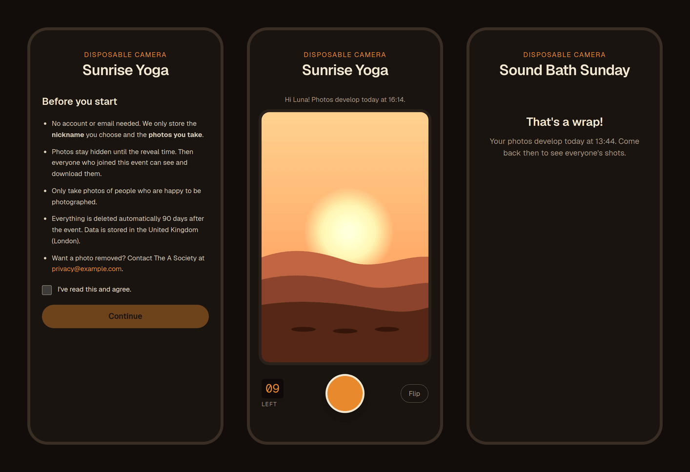

# A Society Cam

A shared **disposable camera** for the events of The A Society, a wellness community. Guests scan a QR code, pick a nickname and get a 12-shot camera right in the browser — nothing to install, no account. Photos stay **hidden until the reveal time**, then everyone gets the whole roll.



<sub>The viewfinder shows an illustrated placeholder instead of a real camera feed.</sub>

> 🚧 **Work in progress.** Joining, the camera and the upload pipeline work end to end. The film effect, the reveal gallery and the organizer panel are next — see the [roadmap](#roadmap).

## Why

At community events, photos usually end up scattered: a few people shoot hundreds of pictures, everyone else is looking at their phone, and the good shots get lost in group chats. A disposable camera fixes that by design. A **limited roll** makes each shot count, and **not seeing the photos right away** keeps people present. The shared reveal afterwards becomes part of the event.

Existing disposable-camera apps do this, but they didn't fit:

- **They ask too much of guests.** Downloading an app or creating an account is a real barrier for a one-off event. Here, scanning a QR code is enough.
- **They look generic.** The community wanted its own look: a custom warm 35mm film treatment and a visual identity that feels like the brand, not a third-party product.
- **The data isn't yours.** Guests' photos live on someone else's platform, under someone else's terms. Building it in-house means full control: where the data is stored, who can see it, and that it is deleted after 90 days (GDPR).

## How it works

1. **The organizer creates an event** and shares its QR code.
2. **Guests scan it,** accept a short privacy notice and choose a nickname. Behind the scenes they get an anonymous session.
3. **Each guest has 12 shots.** Photos are cropped to a 35mm frame, compressed on the phone and uploaded in the background.
4. **At reveal time** (by default two hours after the event ends) the gallery unlocks for everyone who joined, and each print "develops" on screen the first time it's opened.

## Technical highlights

- **The reveal lock is enforced by the database, not the UI.** The storage bucket is private and Row Level Security only allows reads after `reveal_at`, so not even the photographer can fetch or sign a URL for a photo before then.
- **The shot limit is enforced by Postgres.** A `reserve_shot` RPC locks the participant row, so concurrent requests can't exceed 12. It's idempotent per client-generated ID, so retries never cost a shot.
- **Uploads tolerate a bad connection.** Each photo is saved to IndexedDB first, then goes through reserve → upload → confirm. The queue records how far each shot got, so it resumes after dropped connections, closed tabs or reloads, with exponential backoff.
- **No anonymous access to the data.** Events can only be looked up through the slug in the QR link, never listed. Every write goes through validated RPCs, and RLS covers every table.
- **Privacy by design.** Guests get a nickname only (no email), only the processed photo is stored, data stays in a UK region, and events are purged automatically after 90 days.

## Tech stack

- **Next.js 16** (App Router) + **TypeScript** + **Tailwind CSS**: a mobile-first PWA
- **Supabase**: Postgres, Row Level Security, private Storage and anonymous auth
- **WebGL**: an on-device film-emulation shader (in progress)
- **Vercel**: hosting and scheduled jobs
- **Vitest** for unit tests and **Prettier** + **ESLint** for code style

## Roadmap

- [x] Project setup, PWA manifest, deployment
- [x] Database schema with RLS, and the join flow (privacy notice + nickname)
- [x] Camera with live viewfinder, client-side compression and an offline upload queue
- [ ] Warm 35mm film effect (WebGL) with a tuning lab
- [ ] Reveal: countdown, gallery with a "developing" animation, downloads
- [ ] Organizer panel: events, QR codes, moderation, ZIP export
- [ ] GDPR tooling (deletion requests, scheduled purge) and device QA

## Running locally

Requires Node 24 (see `.nvmrc`) and a Supabase project with anonymous sign-ins enabled.

```bash
cp .env.example .env.local   # fill in your Supabase URL and keys
npm install
npx supabase link --project-ref <your-project-ref>
npm run db:push              # apply the database migrations
npm run seed:event           # create a test event and print its link
npm run dev
```

| Script               | What it does                                      |
| -------------------- | ------------------------------------------------- |
| `npm run dev`        | Start the dev server                              |
| `npm run db:push`    | Apply new migrations in `supabase/migrations`     |
| `npm run seed:event` | Create a test event (`-- --name … --hours …`)     |
| `npm test`           | Unit tests (Vitest)                               |
| `npm run lint`       | ESLint                                            |
| `npm run typecheck`  | TypeScript check                                  |
| `npm run format`     | Format all files with Prettier                    |
| `npm run icons`      | Regenerate PNG icons from `public/icons/icon.svg` |
